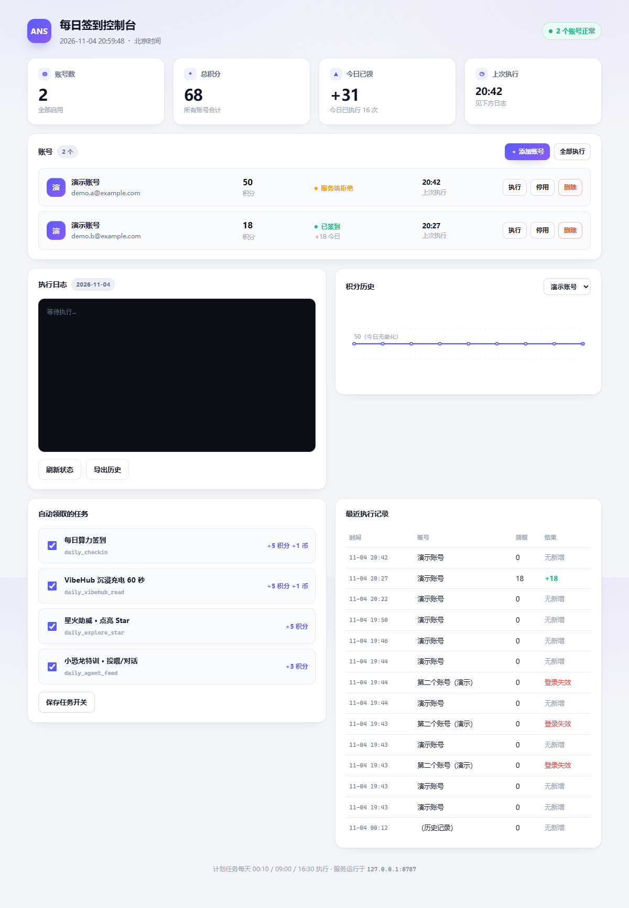

# ANS 每日签到助手

自动完成 [ANS 工作台](https://ans.cauai.fun/workspace/benefits) 的每日签到与日常任务，支持多账号、托盘常驻、定时执行。

> 这是一个本地工具：登录凭证只保存在你自己的电脑上，服务只监听 `127.0.0.1`，不经过任何第三方服务器。



## 特性

- **多账号**：一个账号一个文件，互不影响；某个账号登录失效不影响其他账号
- **三种添加方式**：账号密码 / 粘贴 Cookie / 浏览器登录
- **原生体验**：独立窗口（无地址栏、无标签栏），托盘常驻，执行完弹 Windows 通知
- **定时执行**：注册 Windows 计划任务，每天自动跑
- **零运行时依赖**：只要有 Node.js，不需要 Electron / Tauri / 数据库
- **体积小**：exe 约 40 KB（用系统自带 .NET Framework 编译）

## 安装

1. 安装 [Node.js](https://nodejs.org)（18 或更高版本）
2. 下载或克隆本仓库
3. 安装唯一的前端依赖（仅"浏览器登录"方式需要）：

   ```bash
   npm install
   ```

4. 双击 `ANS签到.exe` 启动。

   没有 exe 时可以执行 `node app.mjs`，然后在浏览器打开 `http://127.0.0.1:8787/`。

## 使用

### 添加账号

点控制台右上角「＋ 添加账号」，三种方式任选：

| 方式 | 说明 |
|---|---|
| **账号密码** | 直接登录换取 Cookie。密码只在内存里用一次，**不落盘** |
| **粘贴 Cookie** | 不想输密码、或账号开了人机验证时用 |
| **浏览器登录** | 弹一个干净窗口手动登录，检测到成功自动保存并关窗 |

重复添加同一个账号是更新登录态，不会产生重复条目。

### 日常

- 「全部执行」：依次跑完所有启用的账号
- 每行的「执行」：只跑这一个
- 「停用 / 删除」：管理账号
- 执行时日志是流式的，边跑边出

### 定时执行

```powershell
.\register-task.ps1                  # 默认每天 00:10 / 09:00 / 16:30
.\register-task.ps1 -Times 09:00     # 只保留一个时间点
.\register-task.ps1 -Unregister      # 删除任务
```

任务以「仅在用户登录时运行」注册，不需要输入 Windows 密码。接口是幂等的，重复执行不会重复加分。

### 开机自启

托盘图标右键 → 「开机自启」。取消就再点一次。

命令行也可以：

```powershell
.\ANS签到.exe autostart-on
.\ANS签到.exe autostart-off
```

## 工作原理

逆向站点前端后确认：**页面上的「签到」按钮本身不产生积分**。

```
点击签到
   ↓
前端只改浏览器 localStorage（ans_quest_arcade_v3）
   ↓
真正记账的是：
   POST /api/compute-benefits/arcade
   {"kind":"quest","questId":"daily_checkin"}
   ↓
服务端返回 {grantedPoints, balanceAfter, duplicate, operationKey}
```

积分、连续签到、抓娃娃币全部由服务端结算，localStorage 只是界面缓存。所以本工具不模拟点击，而是带上有效登录态直接调用该接口——效果和手动点击一致，但更快、更适合无人值守。

登录走站点自己的 NextAuth credentials 流程：

```
GET  /api/auth/csrf                  → csrfToken
POST /api/auth/callback/credentials  → email + password → session-token
```

## 目录结构

```
ANS签到.exe         桌面客户端（托盘 + 通知 + 拉起本地服务）
app.mjs             本地控制台服务（HTTP + 状态汇总 + 执行调度）
ui.html             控制台界面（单文件，无外部依赖）
checkin.mjs         签到主程序（遍历账号 → 领取任务 → 汇总）
lib/accounts.mjs    账号存储（accounts/ 读写、旧版迁移）
lib/ans-auth.mjs    站点认证（密码登录、Cookie 校验）
add-account.mjs     命令行添加账号菜单
login-password.mjs  账号密码登录
import-cookie.mjs   粘贴 Cookie 添加账号
grab-cookie.mjs     浏览器登录后自动抓取 Cookie
desktop/            桌面启动器的 C# 源码与图标
build-exe.ps1       重新编译 exe
register-task.ps1   注册 / 删除计划任务
run-task.ps1        计划任务执行器
```

运行时会在程序目录生成 `accounts/`、`logs/`、`browser-profile-ui/` 等目录，都已在 `.gitignore` 中排除。

## 配置

复制 `config.example.json` 为 `config.json` 后按需修改：

```json
{
  "quests": ["daily_checkin", "daily_vibehub_read", "daily_explore_star", "daily_agent_feed"],
  "retries": 3,
  "retryDelayMs": 2500,
  "timeoutMs": 20000,
  "webhook": "",
  "windowMode": "app",
  "edgeNoSandbox": true
}
```

| 字段 | 说明 |
|---|---|
| `quests` | 要自动领取的任务 ID，留一个也行 |
| `retries` / `retryDelayMs` | 网络失败重试次数与间隔 |
| `webhook` | 可选，执行结果会 POST 到这个地址（企业微信 / 钉钉 / 飞书机器人等） |
| `windowMode` | `app` = 无边框独立窗口；`tab` = 普通浏览器标签页 |
| `edgeNoSandbox` | 个别环境下 Edge 渲染进程起不来导致白屏，会自动降级加 `--no-sandbox`；设为 `false` 可禁用该降级 |

## 从源码构建 exe

```powershell
.\build-exe.ps1
```

用的是 Windows 自带的 `csc.exe`（.NET Framework 4.8），不需要下载任何 SDK，产物约 40 KB。

## 常见问题

**签到返回 `COMPUTE_BENEFITS_FAILED`（HTTP 500）**

这是站点服务端的问题，不是本工具的 bug：用浏览器在签到页真实点击「一键打卡领取」也会得到同样的 500。站点前端对此是"乐观更新"，会照样显示"✓ 已打卡领取"，但积分余额并没有变化。

判断是否真的签到成功，**只看积分余额有没有增加**。

**提示需要重新登录**

NextAuth 会话默认约 30 天。点控制台「＋ 添加账号」重新登录该账号即可，提示文件会自动清除。

**双击 exe 没弹窗**

工具会自动处理几种已知情况（Edge 单实例锁冲突、IPv6 解析、渲染进程起不来），失败原因写在 `logs\open-browser.log`。

## 免责声明

- 本项目仅用于个人学习与自动化实践，与 ANS 平台无任何关联。
- 工具调用的是站点前端自己的接口，不伪造数据、不绕过权限。
- 但自动领取「日常任务」类奖励（点亮 Star、投喂小恐龙等）可能不符合站点活动规则。如果在意账号风险，请把 `config.json` 里的 `quests` 改成只剩 `"daily_checkin"`。
- 使用本工具产生的任何后果由使用者自行承担。

## License

[MIT](LICENSE)
