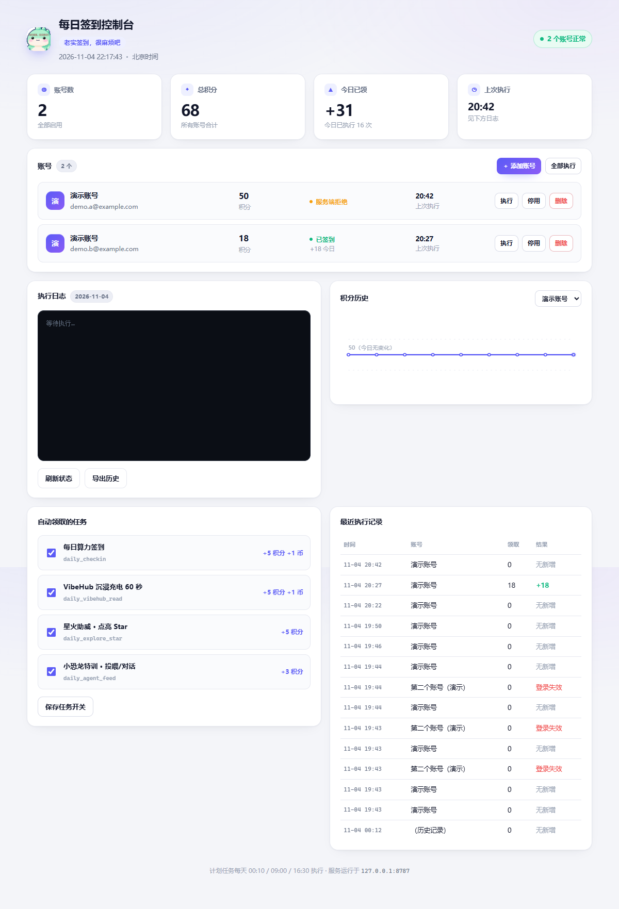
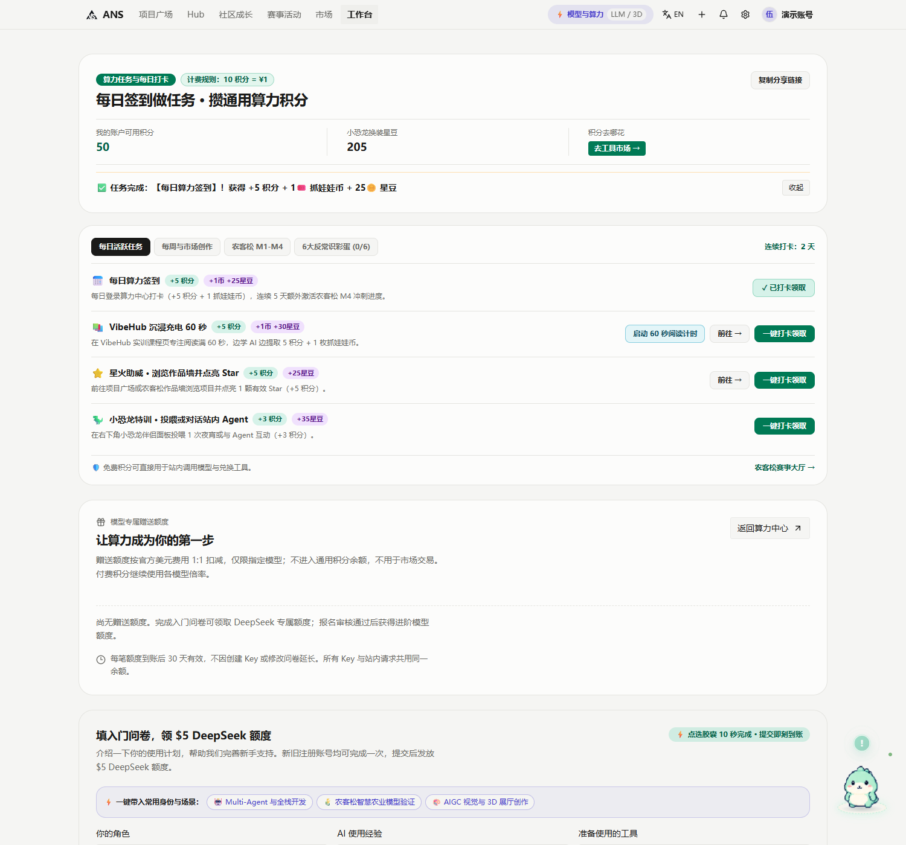
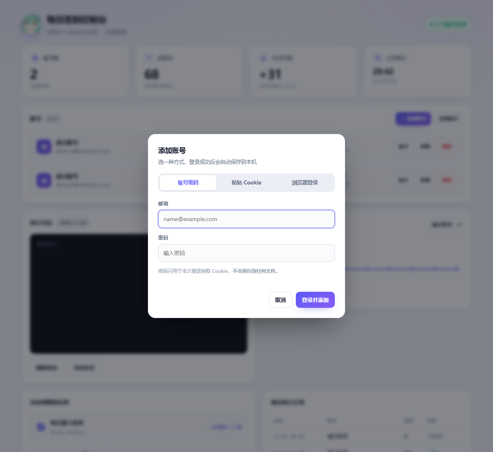

# ANS 每日签到自动执行

自动完成 [ANS 工作台 · 算力福利街](https://ans.cauai.fun/workspace/benefits) 的每日签到与日常任务，**支持多个账号一起跑**，也能注册 Windows 计划任务每天定时无人值守执行。

> **解决什么问题 · 核心功能 · 怎么跑起来 · 适用人群 · 服务边界**：见 **[docs/说明.md](docs/说明.md)**
> 想快速上手，直接往下看就行。

---

## 三种用法，按需选
| 方式 | 入口 | 适合 |
|---|---|---|
| **桌面客户端** | 双击 `ANS签到.exe` | 双击即用，独立窗口（无地址栏、无标签栏），托盘常驻，执行完弹 Windows 通知 |
| **网页控制台** | exe 启动后自动打开 `http://localhost:8787/` | 看积分曲线、改任务开关、手动执行、导出日志 |
| **命令行** | 双击 `运行签到.bat` | 只想跑一次，看完就走 |

桌面客户端是 40 KB 的原生 exe（用系统自带 .NET Framework 编译，**不需要** Electron / Tauri、也不需要装运行时），它只做三件事：后台拉起本地服务、托盘常驻、监听执行结果弹通知。真正的界面在浏览器里。



控制台能做：

- 账号列表：每个账号的积分、今日签到状态、上次执行时间一目了然
- 「全部执行」或对单个账号「执行」
- 点「+ 添加账号」弹出干净浏览器，登录即添加，可重复添加多个
- 某行「停用 / 删除」管理账号
- 实时流式日志（边跑边出，不是等完才显示）
- 单个账号的积分历史折线（下拉切换账号）—— 只有真加到分才会向上走
- 勾选要自动领取的任务，保存即生效
- 「导出历史」下载全部执行记录

托盘菜单：打开控制台 / 立即签到 / 打开数据文件夹 / 开机自启 / 退出。执行结束后会弹通知，内容包含本次加了多少分、哪些账号失败、哪些需要重新登录。

---

## 这个方案是怎么来的

逆向站点前端后确认了一件关键的事：**页面上的「签到」按钮本身不产生任何积分**。

```
用户点击签到
   ↓
前端只改浏览器 localStorage（键名 ans_quest_arcade_v3）
   ↓
真正记账的那一步是：
   POST /api/compute-benefits/arcade
   {"kind":"quest","questId":"daily_checkin"}
   ↓
服务端返回 {grantedPoints, balanceAfter, duplicate, operationKey}
```

积分、连续签到天数、抓娃娃币全部由服务端结算，`localStorage` 只是界面缓存。也就是说：**只要带上有效登录态直接调用这个接口，效果和手动点击完全一致**，不需要打开浏览器。

所以这里没有用「浏览器自动化 + 模拟点击」的做法，理由：

| | 浏览器自动化 | 本方案（直接调接口） |
|---|---|---|
| 每次耗时 | 10～30 秒 | 1～2 秒 |
| 依赖 | 需要常驻 Chromium | 只要 Node.js |
| 无人值守稳定性 | 受弹窗、更新、配置锁影响 | 无 GUI 依赖 |
| 出错排查 | 看截图 | 结构化日志 |

站点认证是 NextAuth 的 credentials 方式（`/api/auth/session`、`api/auth/csrf` 都在），需要登录态 Cookie。

---

## ⚠️ 重要：站点签到接口目前有问题（2026-11-04 实测）

这不是脚本的 bug，是站点服务端的缺陷，实测证据如下。

**现象**：`POST /api/compute-benefits/arcade` 提交 `daily_checkin` 时返回

```
HTTP 500  {"error":"COMPUTE_BENEFITS_FAILED"}
```

**关键验证**：用浏览器（已登录状态）在签到页真实点击「一键打卡领取」按钮，发出的请求体与脚本完全一致：

```
{"kind":"quest","questId":"daily_checkin"}   →  500 COMPUTE_BENEFITS_FAILED
```

但页面仍然弹出「任务完成：【每日算力签到】获得 +5 积分 + 1 抓娃娃币 + 25 星豆」，并把卡片改成「✓ 已打卡领取」、连续打卡 +1 —— **服务端实际没有记账，余额没变**（前后都是 50）。也就是说站点前端是"乐观更新"，把失败也显示成成功了。



**结论**：签到是否真的记上，不能看页面显示，只能看积分余额。

**另外发现的疑点**：其余三个日常任务返回 `duplicate: true`（今日已领过），但页面显示的是未领取状态。从响应里的幂等键能看出服务端用的日期：

```
arcade:quest:{用户ID}:daily_vibehub_read:2026-11-04
```

在 11-04 00:02（北京时间）时该键已经是 `2026-11-04`，而账号在那之前不可能领过 11-04 的任务 —— 说明**服务端的"当日"边界与自然日不一致**，很可能存在时区重复偏移（实际翻日时刻可能是北京时间 16:00 而非 00:00）。

**因此脚本做了两件事**：

1. 把 `COMPUTE_BENEFITS_FAILED` 单独归类为"服务端拒绝"（退出码 `4`），不当成网络故障反复重试
2. 计划任务默认每天 **12:00** 跑一次；时间可以在控制台的「自动任务时间」里随时增删。接口天然幂等，重复执行只会返回 `duplicate`，不会重复加分

跑几天后看 `logs\` 里哪一次真正加到了积分，就能反推出真实的翻日时间，届时把 `register-task.ps1` 的时间收敛成一个即可。

---

## 快速开始（3 步）

### 1. 添加账号（每个账号一次，约 30 秒）

打开控制台点 **「+ 添加账号」**，三种方式任选：

| 方式 | 适合 | 说明 |
|---|---|---|
| **账号密码** | 大多数情况 | 填邮箱 + 密码，直接登录换 Cookie。密码只在内存里用，**不落盘** |
| **粘贴 Cookie** | 不想输密码 / 已经登录过 | 从浏览器复制 Cookie 或整条 cURL 命令粘进来 |
| **浏览器登录** | 账号开了人机验证 | 弹一个干净窗口手动登录，成功后自动保存并关窗 |



**要加第二个、第三个账号，就再重复一次**（换另一个账号登录）。重复登录同一个账号是更新它的登录态，不会产生重复条目。

> 命令行等价操作：
> - `添加账号.bat` —— 菜单，可选上面三种方式
> - `node login-password.mjs` —— 账号密码（密码输入不回显）
> - `node import-cookie.mjs` —— 粘贴 Cookie
> - `node grab-cookie.mjs` —— 浏览器登录


### 2. 试跑一次

双击 **`运行签到.bat`**，会依次跑所有账号，输出类似：

```
=== ANS 每日签到 · 2026-11-04 · 2 个账号 ===
── me@example.com ──
  已登录，当前积分：50
  ! 每日算力签到 → 服务端拒绝（COMPUTE_BENEFITS_FAILED），站点自身点击同样失败
  = VibeHub 沉浸充电 60 秒 → 今日已领过
  积分：50 → 50（+0）
── teammate@example.com ──
  已登录，当前积分：120
  ✓ 每日算力签到 → +5 积分（余额 125）
  积分：120 → 125（+5）
── 汇总 ──
  me@example.com：无新增
  teammate@example.com：+5 积分
=== 完成：2 个账号，共领取 5 积分 ===
```

判断是否真的成功，**只看"积分：X → Y"**，Y 大于 X 才是真加了分。

退出码：

| 退出码 | 含义 | 需要你做什么 |
|---|---|---|
| `0` | 成功，或今日已领过 | 无 |
| `2` | 登录态失效 | 重新双击 `导入Cookie.bat` |
| `3` | 网络/接口异常，已重试仍失败 | 看日志，通常过一会儿会自愈 |
| `4` | 服务端拒绝（`COMPUTE_BENEFITS_FAILED`） | 站点侧问题，无需处理 |
| `1` | 配置或未预期错误 | 看日志排查 |

### 3. 注册每日计划任务

右键 `register-task.ps1` → **使用 PowerShell 运行**；或在 PowerShell 里：

```powershell
.\register-task.ps1                    # 默认每天 12:00
.\register-task.ps1 -Times 09:00       # 换成别的时间
.\register-task.ps1 -Times 09:00,21:00 # 多个时间点
```

任务以「仅在用户登录时运行」注册，**不需要输入 Windows 密码**。若当天错过了触发时间，会在下次开机或登录后尽快补跑（接口幂等，重复执行不会重复得分）。

**也可以直接在控制台里改**：界面底部的「自动任务时间」卡片，点「添加时间」或时间标签上的 × 增删，然后点「保存并更新计划任务」——会立刻改写 Windows 计划任务的触发器，并把当前下次运行时间显示出来。卡片右上角会显示任务状态（已启用 / 未创建）和下次运行时间。

> 为什么是三个时间点：站点的每日重置时刻尚未确认（见上文"重要"一节），多点触发用来覆盖各种可能，成本为零。确认后可以收敛成一个。

---

## 常用命令

| 命令 | 作用 |
|---|---|
| `node checkin.mjs` | 依次执行所有账号 |
| `node checkin.mjs --account 邮箱` | 只执行指定账号（支持 id / 邮箱 / 昵称模糊匹配） |
| `node checkin.mjs --check` | 只检查各账号登录态和积分，不领取 |
| `node checkin.mjs --dry-run` | 只打印将要提交的内容 |
| `node login-password.mjs` | 用账号密码添加/刷新账号 |
| `node import-cookie.mjs` | 粘贴 Cookie 添加/刷新账号 |
| `node grab-cookie.mjs` | 浏览器登录添加/刷新账号 |
| `.\register-task.ps1 -Unregister` | 删除计划任务 |
| `Start-ScheduledTask -TaskName 'ANS每日签到'` | 立即触发一次 |
| `Get-ScheduledTaskInfo -TaskName 'ANS每日签到'` | 查看上次执行结果 |

---

## 多账号

账号存在 `accounts/` 目录，一个账号一个 JSON 文件，互不影响。

**加账号**：控制台点「+ 添加账号」，可选账号密码 / 粘贴 Cookie / 浏览器登录三种方式。重复多少次都行，每加一个就在列表里多一行。

**命令行加账号**：

```powershell
.\添加账号.bat                    # 菜单，三选一
node login-password.mjs           # 账号密码（密码不回显）
node import-cookie.mjs            # 粘贴 Cookie
node grab-cookie.mjs              # 浏览器登录
```

**日常操作都在控制台里**：

- 「全部执行」按顺序跑完所有启用的账号
- 每行的「执行」只跑这一个账号
- 「停用」临时跳过某个账号（不清除登录态，随时启用回来）
- 「删除」移除账号
- 「+ 添加账号」等同于双击 `导入Cookie.bat`

**单个账号登录失效不会影响其他账号**：那个账号会标红「需重新登录」，其余照常执行。文件 `需要重新登录.txt` 会列出失效的账号，全部恢复后自动删除。

**命令行指定账号**：

```powershell
node checkin.mjs --account you@example.com
```

---

## 配置 `config.json`

```json
{
  "quests": [
    "daily_checkin",
    "daily_vibehub_read",
    "daily_explore_star",
    "daily_agent_feed"
  ],
  "retries": 3,
  "retryDelayMs": 2500,
  "timeoutMs": 20000,
  "webhook": ""
}
```

- `quests` — 要自动领取的任务。**只想要签到就删到只剩 `daily_checkin`**
- `retries` / `retryDelayMs` — 单任务网络失败重试次数与间隔
- `webhook` — 可选，填写后会把每次执行结果 POST 到该地址（企业微信、钉钉、飞书机器人等，JSON 体为 `{title, content}`）

可用的任务 ID：

| questId | 名称 | 奖励 |
|---|---|---|
| `daily_checkin` | 每日算力签到 | +5 积分 +1 抓娃娃币 |
| `daily_vibehub_read` | VibeHub 沉浸充电 60 秒 | +5 积分 +1 币 |
| `daily_explore_star` | 星火助威 · 点亮 Star | +5 积分 |
| `daily_agent_feed` | 小恐龙特训 · 投喂/对话 | +3 积分 |

---

## Cookie 过期怎么办

NextAuth 的会话默认约 30 天。过期后：

- 运行时会打印 `✕ 登录态无效`，退出码为 `2`
- 项目目录会生成 **`需要重新登录.txt`**
- 计划任务日志 `logs\last-run.txt` 里能看到同样的原因

处理：在控制台里点「+ 添加账号」，在弹出的窗口里登录这个账号；或者双击 `导入Cookie.bat`。重新登录同一账号会自动覆盖旧凭证，提示文件也会自动清除。

也可以用命令行只补跑过期的那一个：

```powershell
node checkin.mjs --account 过期账号的邮箱
```

---

## 日志

- `logs\2026-11-03.log` — 按天追加的可读日志
- `logs\runs.jsonl` — 每次执行的机器可读记录（含每个任务的返回值）
- `logs\last-run.txt` — 计划任务最近一次的输出
- `logs\launcher.log` — 桌面客户端启动过程（找 node、起服务、打开界面）
- `logs\open-browser.log` — 打开浏览器时 Edge 的退出码与报错（排障用）

日志目录就是程序目录下的 `logs\`。托盘图标右键 → **「打开日志文件夹」** 能直接打开；也可以在文件资源管理器里直接进入这个目录。

---

## 文件说明

```
ANS签到.exe         桌面客户端（托盘常驻 + 通知 + 拉起本地服务）
app.mjs             本地控制台服务：多账号状态 / 流式执行 / 添加账号接口 / 导出
ui.html             控制台界面（含「添加账号」弹层，单文件无依赖）
checkin.mjs         主程序：遍历账号 → 校验登录态 → 领取任务 → 汇总 → 通知
lib/accounts.mjs    账号存储（accounts/ 读写、旧版 session.json 自动迁移）
lib/ans-auth.mjs    站点认证：账号密码登录、Cookie 校验（NextAuth credentials）
add-account.mjs     命令行添加账号菜单（密码 / Cookie / 浏览器 三选一）
login-password.mjs  账号密码登录（密码不回显、不落盘）
import-cookie.mjs   粘贴 Cookie 添加账号
grab-cookie.mjs     打开干净浏览器登录后自动抓取
添加账号.bat         菜单入口
导入Cookie.bat       直接粘贴 Cookie
accounts/           每个账号一个 JSON，含 Cookie（敏感，已忽略）
run-task.ps1        计划任务执行器（定位 node、整体重试、落盘输出）
register-task.ps1   注册 / 删除 Windows 计划任务
set-schedule.ps1    只改计划任务的触发时间，保留动作与设置
build-exe.ps1       重新编译 ANS签到.exe
desktop/            exe 的 C# 源码与图标
config.json         任务开关与参数
browser-profile/    登录时使用的临时浏览器配置（用后即删，已忽略）
browser-profile-ui/ 控制台窗口专用的浏览器配置（同样已忽略）
```

## 修改后重新编译 exe

改了 `desktop/Launcher.cs` 之后，右键 `build-exe.ps1` → 使用 PowerShell 运行，或在 PowerShell 里执行：

```powershell
.\build-exe.ps1
```

用的是 Windows 自带的 `csc.exe`（.NET Framework 4.8），几秒出结果，产物 40 KB 左右。

---

## 已知限制与排障

### 关于「浏览器崩溃」

现在主界面是原生窗口，**日常使用完全不经过浏览器**，这类问题基本消失了。浏览器只在「添加账号」时短暂使用一次，且用独立配置目录。

残留的注意事项：

- 如果添加账号时弹出「现有实例正在以提升的权限运行」，说明有一个**管理员权限的 Edge 实例**在跑。不要点「是」（等于重启你的浏览器），先用任务管理器结束所有 Edge 再重试
- 应用本身已做防护：检测到自己以管理员权限启动时会自动降权重跑，不会再连带产生提权 Edge
- 工具代码里已经**没有任何强杀浏览器进程的逻辑**

历史版本的问题（保留记录）：早期用 Edge 的 app 模式当界面，白屏时用 `taskkill /T` 清理实例，而 Edge 可能把独立配置目录的启动路由到已有进程，存在误伤用户浏览器的风险——这段逻辑已全部移除。

- 控制台服务只监听 `127.0.0.1`（同时监听 `[::1]` 以便 `localhost` 也能访问），**不会暴露到局域网**，凭证不出本机。
- 托盘「开机自启」会在启动文件夹创建快捷方式（带 `auto` 参数，静默起服务不弹窗口）。
- 多账号是**串行**执行的，每个账号之间间隔约 0.6 秒，避免对站点造成突发压力；账号多时整体耗时会线性增加。
- 「添加账号」用的是全新临时浏览器配置，所以**每次都需要重新输入账号密码**（为了支持多账号、避免串号而做的取舍）。

### 开机自启

托盘图标右键 → **「开机自启」** 勾选即可。取消就再点一次。

原理是在 Windows 启动文件夹里放一个指向 `ANS签到.exe` 的快捷方式，参数是 `auto`。

**开机后会自动补签一次**：登录系统后等 25 秒（让网络就绪）自动执行一轮签到。为避免重复，如果最近 6 小时内已经执行过就跳过。所以开机、定时任务两条路径不会互相打架。

也可以用命令行切换：

```powershell
.\ANS签到.exe autostart-on     # 开启
.\ANS签到.exe autostart-off    # 关闭
.\ANS签到.exe checkin-once     # 立刻跑一次签到（不开界面）
```

> 如果菜单里点完提示「设置失败 / 无法保存快捷方式」，请确认这个 exe 是你**自己双击启动**的。若它是被别的工具（比如自动化脚本）拉起来的，那个进程可能没有写启动文件夹的权限；关掉后用资源管理器双击重开一次即可。失败原因会写在 `logs\launcher.log` 里。

### 双击 exe 没弹窗怎么办

已经修过一轮，现在会自动处理下面这些情况，但仍值得知道原理：

1. **Edge 单实例锁冲突**：默认配置目录下 Edge 会报 `Lock file can not be created! Error code: 5` 然后直接退出，窗口根本不出现。  
   → 现在用独立的 `browser-profile-ui/` 启动，绕开你日常浏览器的锁。

2. **`localhost` 解析到 IPv6**：浏览器可能先连 `::1` 而服务只监听 IPv4，页面会一直空白。  
   → 现在用 `127.0.0.1` 打开，服务端也补上了 `::1` 监听。

3. **renderer 起不来导致白屏**：窗口开了但一片空白（任务管理器里能看到 msedge 进程，但没有 `--type=renderer` 子进程）。  
   → 现在会检测"页面是否真的渲染了"，白屏就自动关掉重开，并降级加 `--no-sandbox --test-type`。成功后进程、页面都正常，界面上也不会留下警告条。

如果三种情况都没兜住，会弹一个提示框告诉你手动访问 `http://127.0.0.1:8787/`；同时 `logs\launcher.log` 和 `logs\open-browser.log` 里有完整记录。

### 界面形态

从 v2 起，主界面是 **Windows 原生窗口**（WinForms），**不启动任何浏览器**：账号列表、积分、日志、任务开关、自动任务时间都在原生控件里，数据通过本地 `http://127.0.0.1:8787/api/*` 取。

这样做的原因：之前用 Edge 的 app 模式当界面，会碰到两类问题——独立配置目录偶尔白屏，以及 Edge 实例的权限冲突（提示"现有实例正在以提升的权限运行"，点"是"会把浏览器重启掉）。原生窗口从根上绕开了这些。

**唯一还会用到浏览器的地方是「添加账号」**：登录必须人工交互，会打开一个专门的配置目录窗口，登录完自动保存凭证。

如果你更喜欢网页版界面（样式更丰富），应用运行时直接用浏览器访问 `http://127.0.0.1:8787/` 即可，功能一致。


---

## 安全与合规提醒

- `accounts/` 目录下的每个文件都等同于对应账号的登录凭证，**不要分享、不要提交到公开仓库**（已写入 `.gitignore`）。想作废某个账号的凭证，让该账号在站点上退出登录即可。
- **用账号密码添加时，密码不会保存**：只在内存里换一次 Cookie，换完即丢弃，`accounts/` 里只有 Cookie。
- 本工具走的是站点自己前端在用的同一个接口，不伪造数据、不绕过权限，只代替你完成"点一下"这个动作。
- 但自动领取「日常任务」类奖励（点亮 Star、投喂小恐龙等）本质上是把本该人工完成的互动也自动化了，**可能不符合站点活动规则**。如果担心账号风险，把 `config.json` 里的 `quests` 改成只剩 `daily_checkin`，风险最低。
- 站点若变更接口（改路径、加签名、加风控），脚本会以失败退出并写日志，不会静默作弊。届时更新 `checkin.mjs` 里的 `ORIGIN`/接口路径即可。
